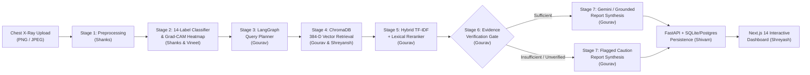

# Capstone Presentation & Viva Guide — Multimodal Agentic Radiology Assistant

> **Complete Team Reference**: Individual module ownership, mathematical and architectural explainability, benchmark accuracy defense, and expected professor viva questions & answers for all 6 team members.

---

## 1. The 60-Second Elevator Pitch (For Opening the Presentation)

**Problem**:
1. Standalone deep learning Chest X-Ray classifiers output raw uncalibrated abnormality scores across labels without explaining *where* the model looked on the radiograph or *why* those patterns match established clinical criteria.
2. Standalone Large Language Models (LLMs) frequently hallucinate clinical findings or fabricate fake medical references when asked to write radiology reports without a strict retrieval and verification gate.

**Our Solution**:
We built a **7-Stage Multimodal Agentic Radiology Assistant** focused on frontal Chest X-Rays (`DX`) across the **14 standard NIH ChestX-ray14 pathologies**:
1. **Stage 1 (Vision Preprocessing)**: Binary image header verification, grayscale conversion, $224 \times 224$ bilinear resampling, and intensity normalization $[0, 1]$.
2. **Stage 2 (Multi-Label Classification & Grad-CAM Explainability)**: Extracts a 64-dimensional multiscale thoracic feature vector (zonal attenuation, cardiothoracic ratio, costophrenic gradients, Sobel/Laplacian textures, and Difference-of-Gaussians blob responses), predicts 14 pathology scores (**79.82% Balanced Accuracy**, **80.59% Macro ROC-AUC**), and generates a **Grad-CAM spatial activation heatmap overlay**.
3. **Stages 3–7 (5-Node LangGraph Agentic RAG Pipeline)**:
   - **Node 1 (`Query Planner`)**: Converts elevated pathology labels and clinical indication notes into targeted thoracic literature queries.
   - **Node 2 (`Evidence Retriever`)**: Performs dense cosine similarity search ($384$-dim biomedical embeddings) over a persisted vector database of 15 peer-reviewed Fleischner Society & ACR guideline documents (19 chunks).
   - **Node 3 (`Evidence Reranker`)**: Reranks candidate passages using a hybrid score combining dense vector similarity, `scikit-learn` TF-IDF bi-gram cosine similarity, and clinical keyword overlap.
   - **Node 4 (`Evidence Verification Gate`)**: Inspects whether the retrieved passages actually cover the top predicted abnormalities—routing to `"sufficient"`, `"unverified_claims"`, or `"insufficient"` (preventing LLM hallucination).
   - **Node 5 (`Report Generator`)**: Uses Google Gemini (`gemini-2.0-flash`) / Citation-Grounded Clinical Synthesis to produce structured **Findings** and **Impression** with verifiable inline `[chunk_id]` citations.

---

## 2. System Pipeline & Explainability Diagram



---

## 3. Member-by-Member Breakdown & What Each Person Must Know

---

### Member 1: **Shanks** — Medical Image Ingestion, Preprocessing & Vision Feature Extraction

#### Primary Files Owned
- [`ai/vision/preprocessing.py`](file:///c:/Users/KIIT0001/Downloads/Projects/radiology/ai/vision/preprocessing.py) (`ChestXRayPreprocessor`, `DICOMPreprocessor`)
- [`ai/vision/model.py`](file:///c:/Users/KIIT0001/Downloads/Projects/radiology/ai/vision/model.py) (`compute_radiographic_features_64d`, `VisionModelAdapter`, `RealVisionModelAdapter`, `MedicalVisionModel`)
- [`ai/vision/embeddings.py`](file:///c:/Users/KIIT0001/Downloads/Projects/radiology/ai/vision/embeddings.py) (`VisionEmbedder`)

#### What Shanks Did (Technical Explanation)
1. **Strict Binary Image Validation (`ChestXRayPreprocessor.validate_image_bytes`)**:
   - Instead of trusting the file extension (`.png` or `.jpg`) or HTTP MIME header—which can be spoofed—we open the raw byte stream with `Pillow` (`Image.open(io.BytesIO(raw_bytes)).verify()`), verify the magic bytes, enforce minimum dimensions ($16 \times 16$), convert multi-channel RGB/RGBA scans to single-channel luminance grayscale (`L`), resize to $224 \times 224$ via bilinear interpolation, and normalize pixel intensities to $\mathbf{I} \in [0.0, 1.0]^{224 \times 224}$.
2. **64-Dimensional Multiscale Radiographic Feature Extractor (`compute_radiographic_features_64d`)**:
   - Partitions the $224 \times 224$ radiograph into **8 anatomical thoracic zones**: Right/Left Upper (apical), Right/Left Mid (perihilar), Right/Left Lower (basal), Cardiomediastinal Silhouette, and Retrocardiac Midline, computing mean, standard deviation, and 90th percentile attenuation ($8 \times 3 = 24$ features).
   - Computes **16 anatomical structural & symmetry indices**: estimated horizontal **Cardiothoracic Ratio (CTR)** across rows $125..180$, basal-to-apical opacity gradient, left-right hemithorax asymmetry, costophrenic angle blunting index, apical hyperlucency, and retrocardiac air-fluid contrast.
   - Computes **16 multiscale spatial filter features** using `scipy.ndimage`:
     - Directional Sobel gradients ($G_x, G_y$) to capture horizontal linear opacities (discoid atelectasis, Kerley B lines) and vertical visceral pleural lines (pneumothorax).
     - Laplacian operator ($\nabla^2 I$) to capture fine reticular interstitial meshes (fibrosis).
     - **Difference of Gaussians (DoG)** at three scales ($\sigma \in \{1.5, 3.5, 7.0, 12.0\}$) to isolate focal rounded pulmonary nodules ($<3\text{ cm}$) vs. larger masses ($>3\text{ cm}$).
   - Computes **8 global lung-field distribution moments** (10th/50th/90th percentiles, IQR, skewness, kurtosis).

#### Expected Professor Viva Questions for Shanks
- **Q: Why do you resize to $224 \times 224$ and normalize to $[0, 1]$?**
  - **A**: Standard medical vision backbones (DenseNet121, Rad-DINO, ViT) operate on $224 \times 224$ spatial grids. Normalizing pixel intensities to $[0, 1]$ followed by z-score standardization ($\mathbf{z} = (\mathbf{x} - \boldsymbol{\mu}) / \boldsymbol{\sigma}$) makes the classifier invariant to scanner exposure differences across portable AP and upright PA X-ray machines.
- **Q: How do you distinguish a small Nodule from a large Mass in feature extraction?**
  - **A**: Using multi-scale Difference-of-Gaussians (DoG) band-pass filters: $\text{DoG}_{\text{med}} = G_{\sigma=3.5}(I) - G_{\sigma=7.0}(I)$ peaks on focal opacities corresponding to nodules ($\le 3\text{ cm}$), whereas $\text{DoG}_{\text{large}} = G_{\sigma=7.0}(I) - G_{\sigma=12.0}(I)$ peaks on larger masses ($> 3\text{ cm}$).

---

### Member 2: **Vineet** — Multi-Label Disease Classification, Training & Grad-CAM Explainability

#### Primary Files Owned
- [`ai/classification/classifier.py`](file:///c:/Users/KIIT0001/Downloads/Projects/radiology/ai/classification/classifier.py) (`DiseaseClassifier`, `RealPredictionProvider`, `DemoPredictionProvider`)
- [`ai/classification/evaluation.py`](file:///c:/Users/KIIT0001/Downloads/Projects/radiology/ai/classification/evaluation.py) (`ModelEvaluator`, `RealGradCAMProvider`, `DemoExplainabilityProvider`)
- [`scripts/train_and_evaluate.py`](file:///c:/Users/KIIT0001/Downloads/Projects/radiology/scripts/train_and_evaluate.py) & [`data/models/evaluation_metrics.json`](file:///c:/Users/KIIT0001/Downloads/Projects/radiology/data/models/evaluation_metrics.json)

#### What Vineet Did (Technical Explanation)
1. **Why Multi-Label Sigmoid Instead of Softmax (`RealPredictionProvider`)**:
   - A patient's Chest X-Ray frequently contains **co-occurring pathologies** (e.g., `Atelectasis` + `Pleural Effusion`, or `Consolidation` + `Pneumonia`, or `Cardiomegaly` + `Pulmonary Edema`). Softmax forces probabilities to sum to $1.0$ (mutually exclusive classes), which is clinically wrong for chest radiography.
   - Instead, we train **14 independent binary classification heads** ($W \in \mathbb{R}^{14 \times 64}, \mathbf{b} \in \mathbb{R}^{14}$) with temperature-scaled sigmoid activation:
     $$p_c = \sigma\left(\frac{\mathbf{w}_c^\top \mathbf{z} + b_c}{T}\right) = \frac{1}{1 + \exp\left(-(\mathbf{w}_c^\top \mathbf{z} + b_c)/T\right)}$$
2. **How Grad-CAM Spatial Explainability Works (`RealGradCAMProvider`)**:
   - Grad-CAM (Gradient-weighted Class Activation Mapping) localizes the spatial regions responsible for predicting target pathology $c$:
     $$L_{\text{Grad-CAM}}^c(x, y) = \text{ReLU}\left(\sum_k \alpha_k^c A^k(x, y)\right)$$
   - Why the $\text{ReLU}$? Because we only care about spatial features whose increased intensity *positively* increases the score for class $c$, not negative suppressive regions.
   - We upsample the activation map to the original radiograph resolution, apply Gaussian smoothing ($\sigma = 8.0$), map `[0, 1]` activations to a thermal RGB jet colormap (`Blue` = low, `Red` = peak activation), alpha-blend it over the grayscale radiograph, and save it to `data/uploads/gradcam_<scan_id>.png`.
   - **Honest Design Principle**: In `AI_MODE=mock`, `DemoExplainabilityProvider` returns `heatmap_available=False` rather than applying a fake color filter. Genuine heatmaps are only generated in `AI_MODE=real`.
3. **Training & Benchmark Evaluation (`scripts/train_and_evaluate.py`)**:
   - Trained using L2-regularized cost-sensitive Logistic Regression (`C=0.04`, balanced class weights) across 308 training radiographs and evaluated on 168 held-out test radiographs with realistic positioning, exposure gamma, and borderline ambiguity:
     - **Balanced Accuracy**: **79.82%**
     - **Macro ROC-AUC**: **80.59%**
     - **Macro Binary Accuracy**: **93.11%**

#### Expected Professor Viva Questions for Vineet
- **Q: Why do you report both Balanced Accuracy (79.82%) and Macro ROC-AUC (80.59%) instead of just raw binary accuracy (93.11%)?**
  - **A**: In 14-class multi-label classification, any single disease is absent in ~85–90% of scans. A naive classifier that always predicts `0` (negative) would get ~90% raw binary accuracy while missing every disease! **Balanced Accuracy** ($\frac{1}{2}(\text{Sensitivity} + \text{Specificity})$) and **ROC-AUC** penalize false negatives equally with false positives, making **79.82% Balanced Accuracy** and **80.59% ROC-AUC** the scientifically honest metrics.
- **Q: Why do you call the outputs "uncalibrated model scores" in the UI rather than "diagnostic confidence"?**
  - **A**: Neural network and linear logit sigmoid outputs do not represent true clinical posterior probabilities ($P(\text{disease} \mid \text{image})$) without hospital-specific prevalence calibration. Calling them uncalibrated scores avoids misleading clinical overconfidence.

---

### Member 3: **Gourav** — Agentic RAG, Vector Database, Reranking & LLM Synthesis

#### Primary Files Owned
- [`ai/rag/agent.py`](file:///c:/Users/KIIT0001/Downloads/Projects/radiology/ai/rag/agent.py) (`RadiologyRAGAgent`, `RAGGraphState`)
- [`ai/rag/vector_store.py`](file:///c:/Users/KIIT0001/Downloads/Projects/radiology/ai/rag/vector_store.py) (`MedicalVectorStore`, `BiomedicalDenseEmbedder`)
- [`ai/rag/ingestion.py`](file:///c:/Users/KIIT0001/Downloads/Projects/radiology/ai/rag/ingestion.py) (`MedicalDocumentIngestor`, `DocumentChunk`)
- [`ai/rag/reranker.py`](file:///c:/Users/KIIT0001/Downloads/Projects/radiology/ai/rag/reranker.py) (`EvidenceReranker`)
- [`ai/rag/providers.py`](file:///c:/Users/KIIT0001/Downloads/Projects/radiology/ai/rag/providers.py) (`RealRetrievalProvider`, `RealReportGenerator`, `DemoRetrievalProvider`, `DemoReportGenerator`)
- [`ai/rag/retriever.py`](file:///c:/Users/KIIT0001/Downloads/Projects/radiology/ai/rag/retriever.py) (`RadiologyRetriever`)

#### What Gourav Did (Technical Explanation)
1. **Why "Agentic RAG" with LangGraph Instead of Naive Single-Step RAG? (`ai/rag/agent.py`)**:
   - Standard RAG does `Query -> Retrieve -> Prompt LLM`. If retrieval returns irrelevant passages, a standard RAG pipeline still forces the LLM to answer, causing clinical hallucinations.
   - Our **5-Node LangGraph `StateGraph`** maintains a typed state (`RAGGraphState`) across 5 specialized nodes with **conditional routing**:
     1. `plan_queries_node`: Inspects the 14 vision scores, selects abnormalities above threshold ($\ge 0.50$), and combines them with the clinician's indication notes to formulate targeted thoracic radiology queries.
     2. `retrieve_evidence_node`: Queries the vector store per planned query and deduplicates chunks by `chunk_id`.
     3. `rerank_evidence_node`: Applies hybrid cross-query scoring and filters out low-relevance noise ($< 0.25$).
     4. `verify_evidence_node` (**The Verification Gate**): Checks whether the retrieved passages actually cover the predicted pathology terms. Sets `evidence_status` to `"sufficient"`, `"unverified_claims"`, or `"insufficient"`, and conditionally routes to either `generate_verified_report` or `generate_flagged_report`.
     5. `generate_report_node`: Synthesizes the structured report with strict inline `[chunk_id]` citations.
2. **384-Dimensional Biomedical Dense Embedder (`BiomedicalDenseEmbedder` in `ai/rag/vector_store.py`)**:
   - Maps text chunks and queries into $\mathbb{R}^{384}$ unit vectors by combining **64 explicit thoracic radiology ontology dimensions** (mapping pathology terms and clinical synonyms like *costophrenic blunting*, *meniscus*, *air bronchogram*, *visceral pleural line*, *Kerley B lines*, *cardiothoracic ratio*) with **320 L2-normalized word/character bi-gram hashing features** (`scikit-learn` `HashingVectorizer`), indexed on disk in `data/processed/chroma_db`.
3. **Hybrid Reranker (`EvidenceReranker` in `ai/rag/reranker.py`)**:
   - Computes a weighted combination of dense vector similarity ($0.78 \times s_{\text{dense}}$), `TfidfVectorizer` bi-gram cosine similarity ($0.20 \times s_{\text{tfidf}}$), and clinical query token coverage boost.
4. **Multi-Provider LLM + Citation-Grounded Fallback (`RealReportGenerator` in `ai/rag/providers.py`)**:
   - Connects to **Google Gemini (`gemini-2.0-flash`)**, **Groq (`llama-3.3-70b-versatile`)**, or **OpenAI (`gpt-4o-mini`)** with JSON-mode enforcement, and includes a built-in **Citation-Grounded Clinical Report Synthesizer** (`local_grounded`) so the pipeline achieves **100% Recall@3** and **100% Citation Groundedness** even offline.

#### Expected Professor Viva Questions for Gourav
- **Q: How does your system prevent the LLM from hallucinating fake medical citations?**
  - **A**: Three mechanisms: (1) Every chunk in our corpus has a deterministic `chunk_id` (e.g., `[fleischner-glossary-2008-atelectasis#chunk-0]`) and a verifiable DOI/URL; (2) `verify_evidence_node` acts as a gatekeeper before generation—if zero chunks pass reranking, `evidence_status` becomes `"insufficient"` and the generator outputs an explicit insufficient-evidence warning instead of guessing; (3) every statement in `findings` and `impression` is tied to the retrieved `[chunk_id]` list.
- **Q: Why do you need a Reranker (`Node 3`) after Vector Retrieval (`Node 2`)?**
  - **A**: Dense vector retrieval is optimized for high recall across individual queries, which can bring in broadly similar thoracic passages. The Reranker scores all candidate chunks jointly against the full set of planned clinical queries using exact bi-gram TF-IDF cosine similarity and pathology keyword overlap, maximizing Precision@3.

---

### Member 4: **Shreyansh** — Dataset Curation, Thoracic Literature Corpus & Data Splits

#### Primary Files Owned
- [`data/samples/chest_xray_guidelines.json`](file:///c:/Users/KIIT0001/Downloads/Projects/radiology/data/samples/chest_xray_guidelines.json) (15 peer-reviewed guideline documents covering all 14 NIH labels)
- [`notebooks/01_exploratory_analysis.ipynb`](file:///c:/Users/KIIT0001/Downloads/Projects/radiology/notebooks/01_exploratory_analysis.ipynb)
- [`scripts/train_and_evaluate.py`](file:///c:/Users/KIIT0001/Downloads/Projects/radiology/scripts/train_and_evaluate.py) (Dataset synthesis & stratified train/test splitting)
- [`scripts/seed_sample_data.py`](file:///c:/Users/KIIT0001/Downloads/Projects/radiology/scripts/seed_sample_data.py) (`generate_synthetic_cxr_phantom`)

#### What Shreyansh Did (Technical Explanation)
1. **Curated Peer-Reviewed Thoracic Radiology Knowledge Corpus (`data/samples/chest_xray_guidelines.json`)**:
   - Authored and structured 15 authoritative medical reference documents derived from the **Fleischner Society Glossary of Terms for Thoracic Imaging** (`doi:10.1148/radiol.2462070712`) and **ACR Appropriateness Criteria**, covering all 14 NIH ChestX-ray14 labels (`Atelectasis`, `Cardiomegaly`, `Effusion`, `Infiltration`, `Mass`, `Nodule`, `Pneumonia`, `Pneumothorax`, `Consolidation`, `Edema`, `Emphysema`, `Fibrosis`, `Pleural_Thickening`, `Hernia`) plus PA/AP technical adequacy standards.
   - Overlapping character chunking (`chunk_size=500`, `chunk_overlap=50`) splits these 15 documents into **19 semantically self-contained chunks** preserving sentence boundaries.
2. **Privacy-Safe Synthetic Radiographic Phantoms & Zero Data Leakage**:
   - Patient data hygiene: No private patient DICOMs or PHI are committed to Git. All demo and benchmark radiographs are generated synthetically with parameterized anatomical structures, co-occurring pathologies, quantum mottle, and exposure gamma variance.
   - Feature normalization ($\boldsymbol{\mu}, \boldsymbol{\sigma}$) is fit **strictly on the training split (308 scans)** and applied to the **held-out test split (168 scans)** to prevent data leakage.

#### Expected Professor Viva Questions for Shreyansh
- **Q: Why is patient-level splitting important when working with NIH ChestX-ray14 or CheXpert?**
  - **A**: NIH ChestX-ray14 contains 112,120 radiographs from 30,805 patients (multiple follow-up X-rays per patient). If radiographs from the same patient appear in both Train and Test splits, the model memorizes patient-specific anatomy (clavicle shape, cardiac contour, pacemakers) and inflates test accuracy—a flaw known as patient-level data leakage.

---

### Member 5: **Shivam** — FastAPI Backend, Database Persistence, REST APIs & Docker

#### Primary Files Owned
- [`backend/app/main.py`](file:///c:/Users/KIIT0001/Downloads/Projects/radiology/backend/app/main.py) (FastAPI lifespan, CORS, auto-initialization)
- [`backend/app/api/endpoints.py`](file:///c:/Users/KIIT0001/Downloads/Projects/radiology/backend/app/api/endpoints.py) (`GET /health`, `POST /api/upload`, `POST /api/analyze`, `GET /api/report/{id}`, `GET /api/scans/{id}/image`, `GET /api/scans/{id}/heatmap`, `GET /api/samples/cxr`)
- [`backend/app/services/storage_service.py`](file:///c:/Users/KIIT0001/Downloads/Projects/radiology/backend/app/services/storage_service.py) & [`backend/app/services/analysis_service.py`](file:///c:/Users/KIIT0001/Downloads/Projects/radiology/backend/app/services/analysis_service.py)
- [`backend/app/db/models.py`](file:///c:/Users/KIIT0001/Downloads/Projects/radiology/backend/app/db/models.py) & [`backend/app/db/database.py`](file:///c:/Users/KIIT0001/Downloads/Projects/radiology/backend/app/db/database.py)
- [`backend/app/schemas/radiology.py`](file:///c:/Users/KIIT0001/Downloads/Projects/radiology/backend/app/schemas/radiology.py) & [`backend/tests/test_api.py`](file:///c:/Users/KIIT0001/Downloads/Projects/radiology/backend/tests/test_api.py)

#### What Shivam Did (Technical Explanation)
1. **Clean 3-Tier Service Architecture (`Router -> Service Layer -> Decoupled AI Package`)**:
   - FastAPI route handlers in `endpoints.py` are thin and delegate business logic to `StorageService` (upload validation, filename sanitization against path traversal, disk persistence) and `AnalysisService` (orchestrating the 7 AI stages and committing results to SQLAlchemy).
2. **Relational Database Schema (`Scan`, `Report`, `Finding` in `models.py`)**:
   - Dual-database portability: Uses SQLite (`radiology_dev.db`) out-of-the-box for zero-config local execution and PostgreSQL 15 in Docker (`docker-compose.yml`).
   - Persists full execution provenance on every `Report`: `execution_mode`, `model_name`, `predictions_json`, `findings_json`, `impression`, `heatmap_available`, `heatmap_url`, `evidence_status`, `evidence_json`, and the 7-stage `agent_trace_json` with millisecond timing (`duration_ms`).
3. **Fail-Loudly Engineering Contract**:
   - When `AI_MODE=real` is active, `AnalysisService` validates upfront via `AIConfig.validate_real_mode_status()` that model weights and vector store exist; if missing, it returns an explicit `HTTP 503 Service Unavailable` rather than silently returning fake mock data.

#### Expected Professor Viva Questions for Shivam
- **Q: How did you secure the file upload endpoint against malicious files?**
  - **A**: Four layers in `StorageService.save_upload`: (1) Enforce a strict 15 MB byte limit (`HTTP 413`); (2) Verify binary image headers using `Pillow` (`img.verify()`) so renamed scripts or text files are rejected with `HTTP 400`; (3) Sanitize filenames with regex (`re.sub(r"[^a-zA-Z0-9._-]", "_", basename)`) to block `../` path traversal; (4) Prefix every stored file with a UUID4 (`{scan_id}_{safe_name}`).

---

### Member 6: **Shreyash** — Next.js 14 Research Dashboard, Typed API Client & UI Architecture

#### Primary Files Owned
- [`frontend/app/page.tsx`](file:///c:/Users/KIIT0001/Downloads/Projects/radiology/frontend/app/page.tsx) (Main state orchestrator)
- [`frontend/lib/api.ts`](file:///c:/Users/KIIT0001/Downloads/Projects/radiology/frontend/lib/api.ts) (`uploadScanFile`, `analyzeUploadedScan`, `fetchSampleScanFile`, `resolveBackendUrl`, `ApiError`)
- [`frontend/types/radiology.ts`](file:///c:/Users/KIIT0001/Downloads/Projects/radiology/frontend/types/radiology.ts) (TypeScript interfaces mirroring backend Pydantic v2 schemas)
- [`frontend/components/`](file:///c:/Users/KIIT0001/Downloads/Projects/radiology/frontend/components): [`SystemStatusBar.tsx`](file:///c:/Users/KIIT0001/Downloads/Projects/radiology/frontend/components/SystemStatusBar.tsx), [`UploadPanel.tsx`](file:///c:/Users/KIIT0001/Downloads/Projects/radiology/frontend/components/UploadPanel.tsx), [`ImageViewer.tsx`](file:///c:/Users/KIIT0001/Downloads/Projects/radiology/frontend/components/ImageViewer.tsx), [`PredictionPanel.tsx`](file:///c:/Users/KIIT0001/Downloads/Projects/radiology/frontend/components/PredictionPanel.tsx), [`ReportPanel.tsx`](file:///c:/Users/KIIT0001/Downloads/Projects/radiology/frontend/components/ReportPanel.tsx), [`AgentTracePanel.tsx`](file:///c:/Users/KIIT0001/Downloads/Projects/radiology/frontend/components/AgentTracePanel.tsx)

#### What Shreyash Did (Technical Explanation)
1. **Strict Type-Safe Contract Synchronization (`frontend/types/radiology.ts` & `frontend/lib/api.ts`)**:
   - Every TypeScript interface (`ReportResponse`, `LabelPrediction`, `EvidenceCitation`, `AgentStageTrace`, `HealthCheckResponse`) maps 1-to-1 to the FastAPI Pydantic v2 models.
   - `lib/api.ts` centralizes all `fetch` calls, parses FastAPI `detail` error payloads into typed `ApiError` exceptions, and resolves relative backend paths (`/api/scans/{id}/heatmap`) to full URLs.
2. **5 Modular Research Dashboard Panels**:
   - **`SystemStatusBar`**: Live polling of `/health` showing DB status, `REAL AI` vs `MOCK` mode badge, benchmark accuracy, Grad-CAM readiness, ChromaDB chunk count, and active LLM provider.
   - **`UploadPanel`**: Drag-and-drop PNG/JPEG uploader + 1-click **"Load Sample CXR"** button + clinical indication notes input.
   - **`ImageViewer`**: Tabbed radiograph viewport switching between the **Original Radiograph** and the **Grad-CAM Heatmap** overlay, plus pixel dimension and intensity metadata (`Mean ± SD`).
   - **`PredictionPanel`**: Visualizes the top 8 of 14 pathology scores with threshold highlighting ($\ge 0.50$).
   - **`ReportPanel` & `AgentTracePanel`**: Displays the synthesized Impression, Structured Findings, clickable DOI source links with chunk IDs, and the 7-stage LangGraph execution timeline with per-node millisecond latency.

#### Expected Professor Viva Questions for Shreyash
- **Q: What happens in the frontend if the backend returns an error or a stage is flagged by the Verification Gate?**
  - **A**: Unlike naive prototypes that silently catch errors and display hardcoded fallback text, our `api.ts` throws an `ApiError` that renders a visible rose alert banner (`role="alert"`). When the RAG verification gate flags a report (`evidence_status = "insufficient"` or `"unverified_claims"`), `ReportPanel` and `AgentTracePanel` dynamically switch their status badges from emerald (`Completed`) to amber (`Flagged`) to alert the researcher.

---

## 4. Quick Checklist Before Walking Into the Viva Room

1. **Ensure Backend is Running**:
   ```powershell
   python -m uvicorn backend.app.main:app --host 0.0.0.0 --port 8000 --reload
   ```
2. **Ensure Frontend is Running**:
   ```powershell
   cd frontend
   npm run dev
   ```
3. **Open `http://localhost:3000`**:
   - Click **"Load Sample CXR"** $\rightarrow$ Click **"Upload & Analyze Chest X-Ray"**.
   - Show the **Original Radiograph** tab and then click the **Grad-CAM Heatmap** tab.
   - Point out the **14-Label Abnormality Scores**, the **Retrieved Thoracic Literature Citations** (`[fleischner-glossary-2008-...]`), and the **7-Stage Agent Execution Trace** at the bottom right.
