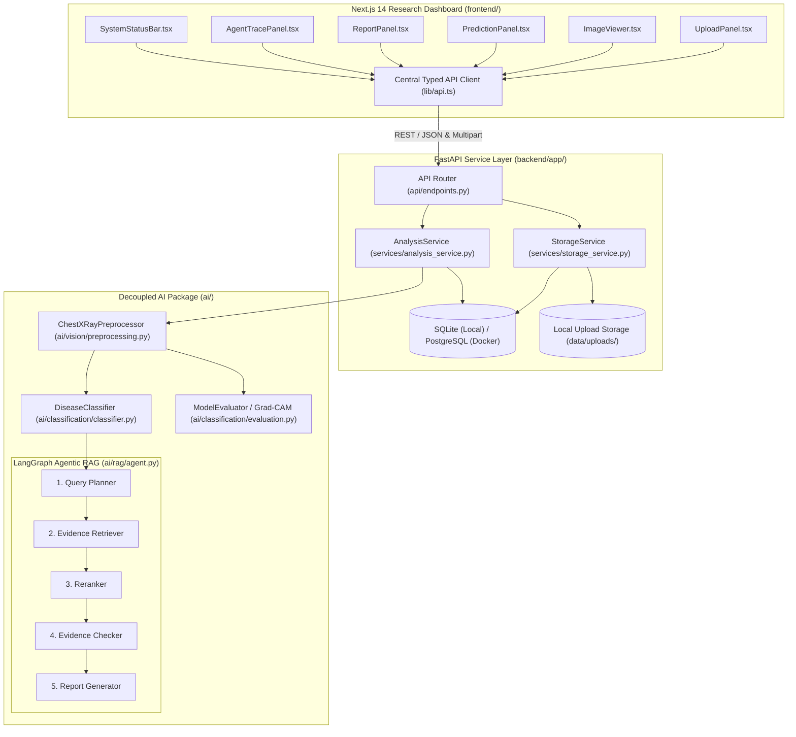

# System Architecture (`docs/architecture.md`)

**Project**: Multimodal Agentic Radiology Assistant (Chest X-Ray Prototype)  
**Scope**: Chest X-Ray (DX) Preprocessing, Multi-Label Abnormality Classification, Grad-CAM Explainability, and LangGraph Agentic RAG Reporting.

---

## 1. High-Level System Architecture

The repository uses a modular monorepo design separating the **Next.js 14 Frontend**, **FastAPI Backend Service Layer**, and **Decoupled AI Layer** (`ai/common`, `ai/vision`, `ai/classification`, `ai/rag`).

---

## 2. Dual Execution Mode (`AI_MODE=mock` vs `AI_MODE=real`)

The system enforces an explicit `AI_MODE` environment setting (`mock` by default):

| Capability | `AI_MODE=mock` (Default Demo Mode) | `AI_MODE=real` (Model Integration Mode) |
| :--- | :--- | :--- |
| **Image Preprocessing** | Real `Pillow` + `NumPy` image validation, grayscale conversion, resizing (`224x224`), and `[0, 1]` normalization | Identical `Pillow` + `NumPy` preprocessing pipeline |
| **Classification** | `DemoPredictionProvider`: Deterministic multi-label Chest X-Ray scores seeded by image intensity statistics | `RealPredictionProvider`: Validates `VISION_WEIGHTS_PATH` checkpoint; raises `HTTP 503` if missing |
| **Grad-CAM Explainability** | `DemoExplainabilityProvider`: Returns `heatmap_available=False`, `heatmap_url=None` (never fabricates fake filters) | `RealGradCAMProvider`: Computes spatial activation maps from loaded convolutional layer hooks |
| **Evidence Retrieval** | `DemoRetrievalProvider`: Retrieves real open-access thoracic guideline passages from `data/samples/chest_xray_guidelines.json` | `RealRetrievalProvider`: Queries persisted ChromaDB collection (`CHROMA_PERSIST_DIR`) |
| **Report Synthesis** | `DemoReportGenerator`: Generates structured findings and impression explicitly tagged with `DEMO MODE` | `RealReportGenerator`: Validates `OPENAI_API_KEY` and invokes configured LLM (`LLM_MODEL_NAME`) |

> **Engineering Rule**: When `AI_MODE=real` is configured, the backend validates required checkpoints and API credentials upfront and returns an explicit `503 Service Unavailable` error detailing any missing integration—it never silently falls back to mock mode.

---

## 3. Agentic RAG State Machine (`ai/rag/agent.py`)

The RAG pipeline is implemented as a 5-node `StateGraph` (`RAGGraphState`):

1. **`query_planner` (`plan_queries_node`)**: Inspects top Chest X-Ray label scores (`score >= CONFIDENCE_THRESHOLD`) and optional clinical notes to formulate targeted thoracic imaging queries.
2. **`evidence_retriever` (`retrieve_evidence_node`)**: Queries the active `BaseRetrievalProvider` for candidate guideline chunks.
3. **`reranker` (`rerank_evidence_node`)**: Scores and orders candidate chunks using `EvidenceReranker` (`ai/rag/reranker.py`) and filters chunks below the minimum relevance threshold.
4. **`evidence_checker` (`verify_evidence_node`)**: Verifies whether retrieved passages cover the predicted abnormalities and sets `evidence_status` to `"sufficient"`, `"insufficient"`, or `"unverified_claims"`.
5. **`report_generator` (`generate_report_node`)**: Synthesizes structured `findings` and `impression` with inline `[chunk_id]` citations, or outputs an explicit caution notice when `evidence_status != "sufficient"`.

Each node records an `AgentStageTrace` entry containing `stage_id`, `stage_name`, `status`, `mode`, `duration_ms`, and `details`.

---

## 4. Database Persistence (`backend/app/db/models.py`)

- **`scans` Table (`Scan`)**:
  - `id` (UUID string primary key)
  - `filename`, `file_path`, `file_type` (`image/png` | `image/jpeg`), `file_size_bytes`
  - `status` (`uploaded` | `analyzed`)
  - `image_metadata_json` (`width`, `height`, `channels`, `format`, `mean_intensity`, `std_intensity`, `modality`)
  - `uploaded_at` (UTC timestamp)
- **`reports` Table (`Report`)**:
  - `id` (UUID string primary key), `scan_id` (FK -> `scans.id`)
  - `status`, `execution_mode` (`mock` | `real`), `model_name`
  - `predictions_json`, `findings_json`, `impression`, `confidence`
  - `heatmap_available`, `heatmap_url`, `explainability_message`
  - `evidence_status`, `evidence_json`, `agent_trace_json`, `model_metadata_json`
  - `created_at` (UTC timestamp)
- **`findings` Table (`Finding`)**:
  - Normalized child rows linked to `reports.id`.
