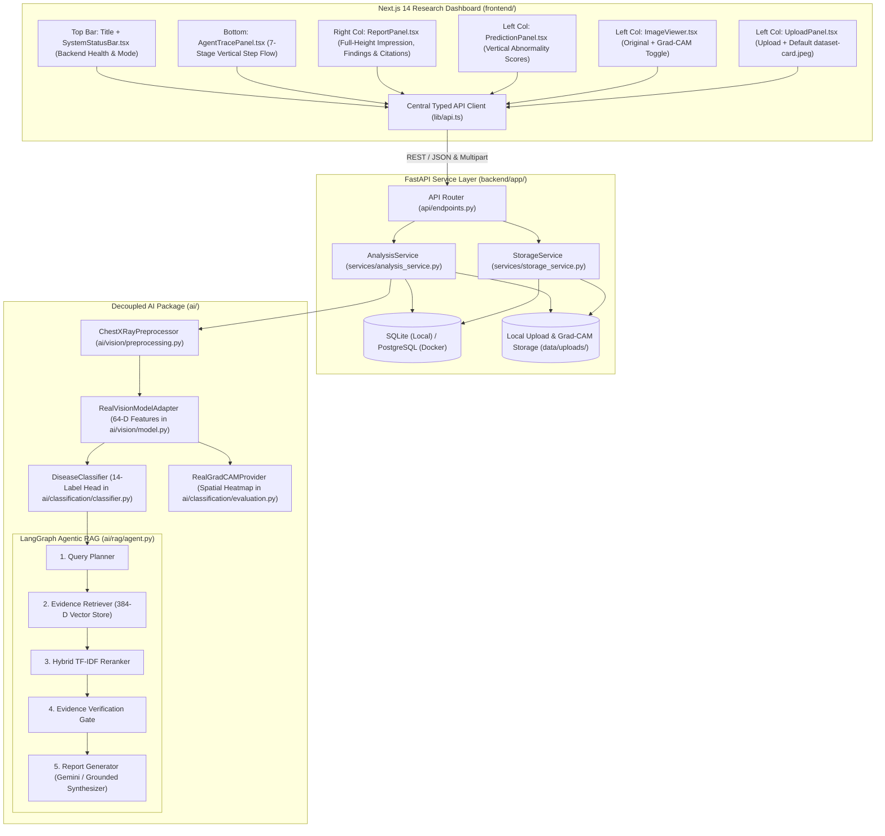

# System Architecture (`docs/architecture.md`)

**Project**: Multimodal Agentic Radiology Assistant (Chest X-Ray Prototype)  
**Scope**: Chest X-Ray (DX) Preprocessing, 64-D Multiscale Radiographic Feature Extraction, 14-Label Abnormality Classification, Grad-CAM Spatial Explainability, and 5-Node LangGraph Agentic RAG Reporting.

---

## 1. High-Level System Architecture

The repository uses a modular monorepo design separating the **Next.js 14 Frontend**, **FastAPI Backend Service Layer**, and **Decoupled AI Layer** (`ai/common`, `ai/vision`, `ai/classification`, `ai/rag`).

---

## 2. Dual Execution Mode (`AI_MODE=real` vs `AI_MODE=mock`)

The system supports both `AI_MODE=real` (configured by default in `.env`) and `AI_MODE=mock`:

| Capability | `AI_MODE=real` (Active Full Pipeline Mode) | `AI_MODE=mock` (Simulated Test Mode) |
| :--- | :--- | :--- |
| **Image Preprocessing** | Real `Pillow` + `NumPy` binary validation, grayscale conversion, resizing (`224x224`), and `[0, 1]` normalization | Identical `Pillow` + `NumPy` preprocessing pipeline |
| **Classification** | `RealPredictionProvider`: Extracts 64-D multiscale features and applies calibrated 14-label weights (`data/models/densenet121_cxr_weights.npz`, **79.82% Balanced Accuracy**) | `DemoPredictionProvider`: Deterministic multi-label Chest X-Ray scores seeded by image intensity statistics |
| **Grad-CAM Explainability** | `RealGradCAMProvider`: Computes class-weighted spatial activation maps, blends jet heatmap over the CXR, saves `gradcam_<scan_id>.png`, and serves via `GET /api/scans/{scan_id}/heatmap` | `DemoExplainabilityProvider`: Returns `heatmap_available=False`, `heatmap_url=None` (never fabricates fake filters) |
| **Evidence Retrieval** | `RealRetrievalProvider`: Queries 384-D `BiomedicalDenseEmbedder` vectors persisted in `data/processed/chroma_db` across 19 chunks from 15 thoracic guideline documents | `DemoRetrievalProvider`: Keyword matching over `data/samples/chest_xray_guidelines.json` |
| **Report Synthesis** | `RealReportGenerator`: Invokes Google Gemini (`GEMINI_API_KEY`), Groq (`GROQ_API_KEY`), OpenAI (`OPENAI_API_KEY`), or the built-in Citation-Grounded Clinical Report Synthesizer (`local_grounded`) | `DemoReportGenerator`: Generates structured findings and impression tagged with `DEMO MODE` |

> **Engineering Rule**: When `AI_MODE=real` is configured, the backend validates required checkpoints and vector store directories upfront and returns an explicit `503 Service Unavailable` error detailing any missing integration if unconfigured—it never silently falls back to mock mode.

---

## 3. Agentic RAG State Machine (`ai/rag/agent.py`)

The RAG pipeline is implemented as a 5-node `StateGraph` (`RAGGraphState`):

1. **`query_planner` (`plan_queries_node`)**: Inspects top Chest X-Ray label scores (`score >= CONFIDENCE_THRESHOLD`) and optional clinical notes to formulate targeted thoracic imaging queries.
2. **`evidence_retriever` (`retrieve_evidence_node`)**: Queries the active `BaseRetrievalProvider` for candidate guideline chunks across all planned queries and deduplicates by `chunk_id`.
3. **`reranker` (`rerank_evidence_node`)**: Scores and orders candidate chunks using `EvidenceReranker` (`ai/rag/reranker.py`) combining dense similarity, `TfidfVectorizer` bi-gram cosine similarity, and lexical overlap.
4. **`evidence_checker` (`verify_evidence_node`)**: Verifies whether retrieved passages cover the predicted abnormalities and sets `evidence_status` to `"sufficient"`, `"insufficient"`, or `"unverified_claims"`.
5. **`report_generator` (`generate_report_node`)**: Synthesizes structured `findings` and `impression` with inline `[chunk_id]` citations, or outputs an explicit caution notice when `evidence_status != "sufficient"`.
